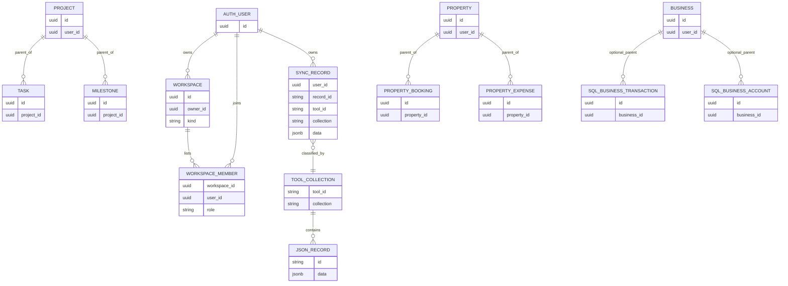
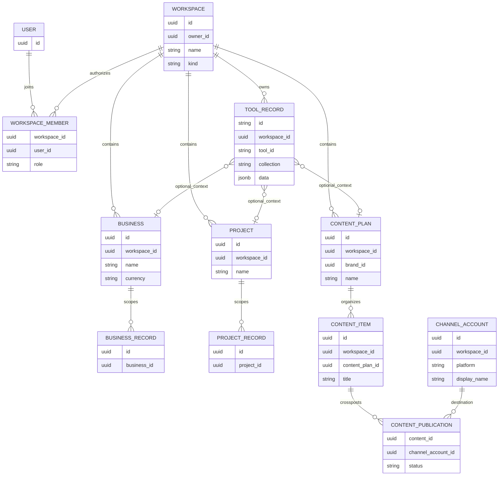

# GridHub cross-tool workspace architecture audit

**Audit date:** 2026-10-31
**Scope:** Read-only source review of the checked-out application and migrations. No production database was queried. No application code, migration, configuration, or user data was changed.

## A. Executive summary

GridHub currently behaves as a collection of user-owned tool datasets, not as a workspace-aware multi-entity platform. The production-facing path creates records in browser IndexedDB, indexes them by `(toolId, collection)`, queues JSON mutations, and syncs those JSON records into `sync_records` keyed by `(user_id, record_id)`. Tool dashboards and integrations read the records by tool and collection. There is no workspace/business/project/plan dimension in that active path.

There are useful but uneven foundations. `workspaces` and `workspace_members` are created at signup, and normalized SQL tables describe businesses, projects, property portfolios, and other domains. The Projects tool also has a working first-class `Project` model with `projectId` on tasks and milestones; Property has `propertyId` on its child records. These foundations are not connected to the active local-first store or sync. Several normalized tables are therefore latent schema, not proof of shipped behavior.

The biggest product risks are data mixing within one account and incorrect reporting once users begin representing separate entities in the same collections. Bookkeeping, inventory, sales, invoicing, and cash-flow have no business identifier in their active TypeScript records. Their dashboards aggregate collection-wide data, with currency filtering applied inconsistently. Wedding records are also flat collections without an event ID in the active type definitions. Content has platform and campaign labels, but no brand, channel-account, or content-plan identity. Existing SQL relations do not solve these problems until the app writes, reads, validates, and filters by them.

**Recommendation:** adopt a small hybrid model: make every user record belong to a stable workspace, then add only the domain IDs that represent real independent contexts (`businessId`, existing `projectId`, `weddingId`, and content plan/channel IDs). Keep personal tools workspace-scoped but do not force every personal record into artificial business/project abstractions. Preserve local-first operation with client-generated stable IDs and a workspace-aware outbox. Enforce workspace membership on the server and in database RLS before enabling shared access. Treat “All” as a reporting filter, never as the destination for a new record.

## B. Complete 16-tool matrix

“User-scoped” means the active app storage/sync is per signed-in account, not that a tool currently has independent business or workspace scopes. “Multiple” describes record instances supported by current collections, not independently scoped plans.

| Tool | Current scope / entities | Multiple instances | Existing entity IDs / internal navigation | Isolation and dashboard status | Recommended changes | Priority |
|---|---|---:|---|---|---|---|
| Ultimate Annual Budget Planner (`budget`) | User/tool collections: accounts, categories, transactions, month/category budgets, recurring bills | Yes, rows and periods | Account/category IDs; transaction account/category links. No budget-plan ID. | User-level isolation only; one dashboard aggregates the tool collection and chosen currency/period. | Add `workspaceId`; add `budgetPlanId` only if users need independent plans; define account and reporting currency rules. | P2 |
| Monthly & Paycheck Budget Planner (`paycheck`) | Schedules, paychecks, allocations; also reads budget, savings, and debt records | Yes | `scheduleId`, `paycheckId`, `paidTransactionId`, `goalId`/`debtId` links. | No workspace scope. Dashboard chooses a period paycheck (latest fallback); connected tools pull from account-wide collections. | Add workspace scope to all records and ensure cross-tool links cannot cross workspace; keep paychecks independent from budget plans unless product requires a plan. | P2 |
| Debt Snowball & Avalanche Tracker (`debt`) | Debts, payments; linked budget transaction/paycheck IDs | Yes | `debtId`, optional `transactionId`, `paycheckId`; no portfolio/plan ID. | One user-wide portfolio by default; strategy dashboard supports All Debts or a selected debt, but no business/workspace scope. | Add workspace scope; retain portfolio “All Debts”; add a debt-plan ID only if multiple repayment plans become a requirement. | P2 |
| Savings Goals & Emergency Fund (`savings`) | Goals and goal movements | Yes | `goalId`, optional transaction link; dashboard selects the first goal as initial display fallback. | User-wide goals; KPIs combine goals. No workspace scope. | Add workspace scope; consider a goal-group only if users need distinct plans; maintain explicit currency grouping. | P2 |
| Net Worth & Investment Tracker (`net-worth`) | Assets/liabilities, holdings, snapshots, investment activity, allocation targets | Yes | Linked debt ID and snapshot/item identifiers; no portfolio/account context ID. | Data aggregates by user and selected currency; different accounts/portfolios can blend. | Add workspace scope and optional portfolio/account grouping; preserve currency-separated summaries. | P2 |
| Small Business Bookkeeping (`bookkeeping`) | Transactions, accounts, contacts, categories | Yes, records only | Transaction references account/category/contact; active `Business` type has no relation to these records. | **No business isolation.** P&L, charts, KPIs, and forms use all bookkeeping records; new entries default to first account. | First business tool to scope: business entity selector, `businessId` on every relevant record, validation, migration and isolated reports. All Businesses is reporting-only. | P1 |
| Inventory Management (`inventory`) | Products, contacts/suppliers, stock movements | Yes | Movement `productId`; product supplier reference; no business ID. | **No business isolation.** On-hand/value/low-stock calculations aggregate products and movements tool-wide. | `businessId` on products, contacts/suppliers and movements; derive totals and stock state by business; constrain references to same business. | P1 |
| Sales & Revenue Tracker (`sales`) | Sales, targets, products, contacts | Yes | Sale `productId`, `customerId`, `invoiceId`; target period. No business ID. | **No business isolation.** Sales summaries filter currency in some views but not business. | Scope sales, targets, product/contact references and metrics by business; define posted/invoiced/paid and currency aggregation. | P1 |
| Invoice & Payment Manager (`invoicing`) | Invoices with embedded lines, payments, contacts | Yes | Payment `invoiceId`; invoice customer ID. No business ID. | **No business isolation.** Some KPI code filters invoices by currency and payments through invoice IDs; no business filter. | Scope invoices/payments/contacts and numbering by business; require same-business parent relationships. | P1 |
| Cash Flow Forecast (`cash-flow`) | Forecast items and scenarios | Yes, but UI/metrics select `scenarios[0]` | No scenario ID on items; scenario entity exists without a shared forecast/plan ID. | **No business isolation;** multiple scenarios can exist but chart/KPI selects the first and applies all items. | Introduce forecast/plan identity and business scope; bind items to scenario/forecast; never rely on row order as current context. | P1 |
| Ultimate Wedding Planner (`wedding`) | Event date/budget, guests, vendors, expenses, payments, tables, tasks | Rows yes; independent weddings not in active app model | Guest table, vendor payment links; no `weddingId` in active child types. | Records from a second event would mix. SQL has nullable `wedding_id` only on guests; several child relations are incomplete. | Add a first-class wedding/event parent and explicit parent ID for all child collections; first wedding can be safely migrated to a default event only after validation. | P2 |
| Rental Property & Airbnb Manager (`property`) | Properties, units, bookings, expenses, maintenance | Yes | `propertyId`/`unitId` already present and used to filter portfolio calculations. | Best existing domain isolation; currently all properties in a currency form one portfolio. No business/workspace scope. | Add `workspaceId`; optionally link business-owned properties to `businessId`; keep portfolio All view currency-safe. | P2 |
| Gridhub Nutrition (`nutrition`) | Foods, logs, recipes, grocery list | Yes, food/log rows | `foodId`; recipes contain ingredient data but no explicit typed recipe-parent relationship in current `RecipeIngredient`. | User-wide diary; no meal-plan or household/workspace selection. Likely no need for business/project contexts. | Add workspace scope only; avoid unnecessary plan IDs unless multiple people/diaries are a product requirement. | P3 |
| Project Management Dashboard (`projects`) | Projects, tasks, milestones, dependencies | **Yes, projects are first-class** | `projectId` on tasks/milestones; dependencies link task IDs. | Project IDs exist, but no workspace ID or workspace selector. Board and overview KPIs read all tasks; tables expose project selection. | Reuse `Project`; add `workspaceId` to projects and enforce child/project scope. Add All Projects report filter; selected project must filter board, charts, and KPIs consistently. | P1 |
| Habit & Productivity Tracker (`habits`) | Habits and completions | Yes | Completion `habitId`; no project/plan ID. | Account-wide metrics; this is reasonable for a personal habit tool. | Add workspace scope; optional grouping only if users ask for separate routines/people. | P3 |
| Social Media Content Planner (`content`) | Posts and campaigns; post platform string, campaign label | Yes | Current `ContentPost.campaign` is a string; SQL has campaign ID; no brand, plan, or channel-account ID. | User-wide content pipeline, all posts can be grouped in one KPI. Multiple accounts on one platform cannot be distinguished. | Add brand/workspace, content-plan, and channel-account concepts; model cross-posting with a join/association instead of duplicate post bodies. | P1 |

## C. Existing data model and data flow

### Active application path

1. Tool definitions declare a `toolId` and collections; tool tabs read and write rows through `useCollection` / `createRecord` (`lib/catalog.ts`; `components/tools/ledger-tool.tsx`; `lib/store.ts`).
2. `BaseRecord` has an ID, timestamps, soft-delete flag, and version, but no owner, workspace, business, or generic parent ID (`lib/types.ts:4-12`).
3. Dexie stores opaque JSON in `records`, indexed by `id`, `toolId`, `collection`, `updatedAt`, `dirty`, and `[toolId+collection]`; list queries are exactly the tool/collection pair (`lib/db.ts:18-33`, `lib/store.ts:44-56`).
4. Local writes update IndexedDB and append serialized JSON to an outbox. The sync payload carries `toolId`, `collection`, record ID, operation, and payload; it does not carry a workspace scope (`lib/store.ts:72-149`, `lib/sync.ts:43-60,97-113`).
5. `/api/sync` authenticates a Supabase user, passes the derived `user.id` to the RPC, and pulls only rows matching that `user_id` (`app/api/sync/route.ts:24-44,54-106,110-141`). The RPC is `security invoker`, checks `auth.uid() = p_user_id`, and upserts by `(user_id,record_id)` (`supabase/migrations/0005_atomic_sync_upsert.sql:2-46`).

This is sound account-level isolation, but not workspace sharing or business isolation. A client cannot request another account's sync records through the observed route because user identity is derived from the verified bearer token and the query is filtered to that user. The route accepts arbitrary tool/collection/payload values for that authenticated user's own store, which means future scope fields still need server-side validation and must not be trusted merely because they came from the UI.

The IndexedDB tables and outbox have no authenticated account key. The browser database persists independently of sign-in; local-only rows therefore cannot be safely attributed to the currently signed-in account after an account switch. Phase 1 must partition or quarantine local data on account transitions and must not automatically upload unattributed rows. Also, `docs/SYNC_ENGINE.md` describes `sync_mutations` as the idempotency authority, but the active RPC in migration `0005_atomic_sync_upsert.sql` implements retry handling through the `(version, client_mutation_id)` predicate on `sync_records` and does not insert into `sync_mutations`. Align this documentation and test the exact retry protocol before extending it to workspace-scoped sync.

### Existing workspace and relational schema

`workspaces` has UUID, owner, name, and `personal|business` kind; `workspace_members` stores a workspace/user/role pair (`supabase/migrations/0001_init.sql:41-56`). Signup creates a personal workspace and owner membership (`:1404-1427`). But repository search found no workspace read/write usage in `app`, `components`, or `lib` beyond the sync-record path being absent, signup/bootstrap, admin counts, and descriptive copy. No workspace selector or local selected-workspace state is wired into tools.

The migration defines a normalized SQL domain schema. Business rows have `businesses`; accounts and transactions have nullable `business_id`, while contacts, categories, products, movements, sales, targets, invoices, payments, and forecasts do not consistently have it (`0001_init.sql:428-673`). Projects/tasks/milestones are normalized and tasks/milestones have project IDs (`:984-1029`). Property descendants have property IDs (`:775-821`). Most of these SQL records are not used by application code: searches found no application `.from(...)` reads for those domain tables. The active sync route reads/writes `sync_records` only. Treat normalized rows as an unused/latent persistence design until a caller is verified.

The normalized schema's RLS policies are mostly `auth.uid() = user_id` and workspace policies only authorize `owner_id` (`0001_init.sql:1225-1284`). `workspace_members` has its own user_id policy, but there are no observed policies allowing a member role to read a workspace or authorize domain data by membership. Role values (`owner/admin/member/viewer`) therefore do not currently imply working shared access. Future policies must validate both role and the parent workspace/business relationship.

### Mermaid — current observed relationships

The diagram intentionally separates the app's JSON record path from unused relational tables; it is not a claim that JSON records are currently children of those SQL parents.

## D. Proposed target architecture

Use one workspace as the ownership/access boundary, with multiple businesses, projects, content plans, and optional other domain contexts inside it. Keep tool collection names stable initially, but add explicit fields to record payloads. The same workspace ID must be indexed locally and represented in cloud sync. Child relations should be both validated and scoped to the same workspace. A cross-post should refer to one content item and multiple channel accounts through an association rather than copying the content record.

Recommended invariants:

- Every new record has `workspaceId`; businesses and projects belong to one workspace. `businessId`, `projectId`, `weddingId`, and `contentPlanId` remain optional domain links only where applicable.
- `workspaceId` is authoritative for access; domain IDs are filters and parent-child integrity, not substitutes for workspace authorization.
- Personal tools get workspace ownership without artificial business grouping. A record may relate to both a business and a project only through explicit product rules.
- IDs are client-generated UUIDs so offline parent/child creation works before upload. Keep IDs stable through migration and sync.
- “All Businesses”, “All Projects”, and “All Content” are read/reporting scopes. Create flows require a concrete destination context.
- Cloud sync should return records for authorized workspace memberships and enforce workspace write roles. Membership revocation must remove or quarantine stale local cache and prevent subsequent writes.

### Options comparison

| Option | Benefits | Risks / cost | Assessment |
|---|---|---|---|
| A. Add tool-specific business/project/plan IDs while retaining user-scoped storage | Small client/schema delta; easier offline compatibility; does multi-business per owner; lets project model be reused. | Does not create shared workspaces; duplicated access rules; user-scoped sync still downloads all workspaces and cannot revoke membership-scoped cache; inconsistent filtering likely across dashboards. | Useful first transition only if collaboration is explicitly out of scope. Insufficient as the long-term platform requested. |
| B. Unified workspace-aware record model with tool-specific child IDs | Consistent scope boundary for all tools; makes membership, sharing, revocation and cross-tool relationships coherent; keeps tool-specific semantics. | Larger migration; must redesign sync authorization, RLS, cache invalidation, offline outbox and record queries together; risk of a large all-at-once release. | Recommended, implemented incrementally. Do not force every tool to have a business/project/plan ID. |

## E. Tool-by-tool findings

### Money tools

All five are local-first user datasets. Their many rows are not equivalent to multiple independent plans. Budget entries tie to category/month, paycheck records link to schedule, debt payments to debt, savings movements to goals, and net-worth records to dated assets/holdings. These links are useful and must be preserved. `Paycheck` consumes data from budget, savings, and debt collections, so context fields must match across those links. Current dashboard calculations use a selected currency in some places but other collections and selected records remain account-wide. Start by attaching workspace scope; only add named plan IDs for a demonstrated need.

### Business tools

Bookkeeping is a high-priority gap. The active `Business` interface contains only name, currency and fiscal-year start; `BusinessTransaction`, `BusinessAccount`, and `BusinessContact` have no `businessId` (`lib/types.ts:221-262`). `bookkeepingTabs` reads the shared accounts/contacts collections and sets a new transaction's account to `accounts[0]` (`lib/tools/business.tsx:37-60`). KPIs and charts aggregate transactions directly (`components/tools/tool-view.tsx:304-317,1098-1108`). Inventory, sales, invoicing, and cash-flow follow the same pattern: domain entities exist but lack a uniform business parent, and aggregate helpers accept whole collection arrays. This makes per-business reports impossible without explicit filters and will otherwise mix same-user company data.

The SQL business schema is not a safe incremental shortcut. It has `business_id` only for `business_accounts` and `business_transactions` in the inspected business table definitions, while products, suppliers, movements, sales, invoices and cash forecasts lack it (`0001_init.sql:428-673`). Contacts/categories are also unscoped. Relational references such as a transaction's account/contact should be constrained to the same business. Inventory quantity is derived from posted movements; splitting only the product list without movement scope would corrupt stock calculations.

Currency must be handled before an “All Businesses” financial total is shown. Keep totals separated by currency or use a documented, dated exchange-rate service and disclose conversion date/source. Reporting periods should be normalized by business fiscal year/time zone.

### Projects

Projects is the strongest reusable multi-instance model: `Project` is first-class; tasks and milestones hold `projectId`; dependencies link tasks (`lib/types.ts:522-554`, `lib/tools/work.tsx:22-115`). However there is no `workspaceId`, and the project board renders all tasks grouped by status (`components/tools/tool-view.tsx:823-858`). Tool KPI code uses all tasks for completion and due counts (`:1221-1230`). The ledger task form allows choosing a project, but a project ID on a row does not itself cause the board/KPIs to isolate it. Reuse this project model and add consistent selected-project filtering to every view, without creating a second project abstraction.

The existing SQL projects schema resembles this structure, but does not participate in active sync. A project deletion currently soft-deletes its project record in local storage; child tasks remain independent JSON rows, unlike SQL `ON DELETE CASCADE`. Project archive/delete semantics must therefore be explicit before introducing cascades.

### Content planning

The active model has post platform as a string and campaign as a string; campaigns are independent records, but no `contentPlanId`, brand ID, or channel-account ID (`lib/types.ts:572-590`, `lib/tools/work.tsx:178-240`). The form's campaign selector uses campaign options while the persisted field remains named `campaign`, so it can hold an option ID while consumers may treat it as a display name; this needs explicit normalization. SQL has content-platform lookup and campaign tables and `campaign_id`, but no active app caller; SQL has no channel account entity (`0001_init.sql:1076-1123`).

Model a content item once; use publication/destination records for platforms/accounts. A platform enum is not a channel account: users may have multiple accounts on the same platform. Brand can be a workspace-level identity or a plan property, but campaign is a marketing grouping and must remain distinct from plan and channel. Preserve manual publish confirmation and metrics.

### Other tools

Property already has portfolio and per-property IDs; no extra property-plan abstraction is needed. Wedding needs an event parent because its current child collections are global within the tool and do not carry `weddingId`; SQL's optional wedding ID only on guests is incomplete. Nutrition and Habits are naturally personal, and should not inherit business/project complexity absent a real user need. Workspace ownership may still be useful for account-level organization and collaboration, if those products are intended to be shared.

## F. Security findings

Severity reflects future workspace rollout risk, not evidence of a known cross-user data breach.

| Severity | Finding | Evidence / implication |
|---|---|---|
| P0 before shared-workspace release | Workspace membership is not an active record authorization path. | Workspace exists and roles are stored, but app has no workspace calls; policy for `workspaces` allows owner only, and record RLS remains user_id-only (`0001_init.sql:1258-1284`). Do not promise collaboration before membership-aware read/write enforcement is implemented. |
| P0 before workspace-scoped sync | Client payload context cannot be trusted for access control. | Sync route accepts arbitrary JSON payload and tool/collection names, with server-authenticated user ID (`app/api/sync/route.ts:54-106`). This is safe for current account ownership, but future workspace IDs need server membership/role validation on every mutation. |
| P1 integrity | Parent-child references are not consistently protected against cross-scope links in normalized schema. | User-ID policies on child rows do not necessarily prove the referenced parent has the same owner/workspace. Examples: task/project and invoice/payment references. Add composite unique keys/foreign keys or RLS `exists` checks. The schema appears unused by the current app sync path. |
| P1 integrity | Soft deletion and access revocation need separate semantics. | Local records hide soft-deleted rows; sync pulls JSON per user. There is no observed membership cache eviction or workspace revocation flow. Avoid serving cached shared records after membership removal. |
| P1 privacy | Account deletion cascade and browser cache are separate. | Deleting auth user cascades cloud rows, but documentation says a browser that does not return may retain IndexedDB (`app/api/account/delete/route.ts:6-21`). Workspace transfer/deletion needs an explicit local-cache policy too. |
| P2 authorization | Membership role labels are not permission enforcement. | `owner/admin/member/viewer` are values in `workspace_members`, but no tool-specific server permission check was found. Define read/write/admin operations and reject role escalation server-side. |

No direct cross-user exposure was demonstrated in this source audit. The live route derives user identity from a verified bearer token, filters reads by `user_id`, and the SQL sync upsert checks `auth.uid()` against the supplied user ID (`app/api/sync/route.ts:24-44,114-125`; migration `0005_atomic_sync_upsert.sql:19-21`).

## G. Migration strategy

Migration must be additive, idempotent, and run alongside the old format until reconciliation succeeds.

1. **Inventory and backup:** export per-user local and cloud records by stable `toolId`, `collection`, `recordId`, current version, and update time. Identify users with local-only/outbox records, duplicate IDs, invalid parent references, mixed currencies, and multiple implicit business/event groups. Do not infer ownership from names or dates.
2. **Create stable workspace mapping:** retain existing workspace UUIDs where possible. For existing accounts with no workspace row, create one deterministically/idempotently. Associate old personal records with that account's personal workspace only if the owner and migration policy are unambiguous. Business assignments for old records cannot be safely inferred; route those users through a one-time “keep in current business / create business / leave unassigned” choice or a review step.
3. **Additive record fields and local DB version:** add `workspaceId` to local record envelope (rather than only business payload); add Dexie indexes for workspace and scope. Keep old collection keys stable. Backfill existing IndexedDB from current account/workspace mapping and retain unsynced outbox payloads; dual-read during rollout.
4. **Cloud sync v2:** support workspace-bound mutations and cursors with stable IDs. Validate workspace membership and role server-side for push and pull. Keep old user-scoped sync available until every client can read/write the new format; define how two device versions interoperate. Use workspace+record identity or globally unique record identity with workspace consistency constraints; do not use unvalidated client-supplied owner IDs.
5. **Backfill and verify:** for each record ensure one old-to-new mapping; preserve IDs, `createdAt`, versions, deleted flags, embedded history, and invoice/sale/source links. Reconcile counts and checksums per user/tool/collection/workspace. Report unresolved child links. Never duplicate JSON records into relational tables and active sync simultaneously without an explicit source-of-truth/cutover plan.
6. **Enable one vertical slice:** business selector plus Bookkeeping first. Scope every query, creation path, KPI, chart, import/export, quick add, dashboard aggregate, AI context/action and background integration by business/workspace. Include currencies in aggregate rules.
7. **Then Projects and Content:** reuse project IDs, add selected context consistently; add content plans/channel accounts with cross-post association. Add remaining business tools and optional wedding event scoping after the underlying foundations are proven.
8. **Retire legacy only after adoption:** monitor old client sync and outbox drains; retain rollback snapshot/export. Do not drop old columns or tables until counts, links and conflict reports are clean and the rollback window closes.

Safe to automate: assigning a record to a user's sole default personal workspace when the user has exactly one and ownership is certain; preserving ID and timestamps; generating deterministic migration mappings; retrying idempotent backfills. Requires user or product decision: which business owns unscoped transactions when a user has multiple businesses; whether records are personal vs business; how to split existing content into plans; which currency conversion policy to use; whether a property belongs to a business; and whether an event's existing wedding rows represent one or multiple weddings.

## H. UX recommendation

Use `Account → Workspace → Tool → Context → Records`, but keep workspace switching quiet for solo users with only one workspace. A desktop switcher can live in the shell; on mobile expose the same switcher in the existing navigation drawer and within context menus. Persist selected workspace, but default safely to the personal workspace if stale or inaccessible. When reopening a tool, use its “All” reporting view if one exists, never silently choose the first business/project/plan. When creating a record, require or prefill a concrete context.

- **Bookkeeping:** `All Businesses | Poultry Farm | Grocery Shop | + Add Business`; All Businesses shows separate currency totals and comparisons, while Add Transaction requires a selected business. Business accounts, contacts and categories default/filter to that business unless explicitly shared.
- **Projects:** `All Projects | Website Launch | YouTube Growth | + New Project`; All Projects gives aggregated counts and cross-project timeline, while project board and details show selected-project records. Keep project selection in URL/UI state, not duplicated per widget.
- **Content:** `All Content | GridHub X | GridHub Instagram | Personal YouTube | + New Plan`; plan is a brand/campaign strategy container, while channel account is a publishing destination. One content item can have multiple planned/published destinations.

Avoid additional selectors when only one context exists; show the active context label and reveal management actions only when useful. Preserve existing glassmorphic cards, colors, tabs, FABs, and responsive breakpoints.

## I. Implementation roadmap

No code changes are proposed in this audit. A future implementation should be staged as follows.

| Phase | Scope and dependencies | Likely affected files / schema areas | Required validation, risks, acceptance |
|---|---|---|---|
| 0 — Contract & migration rehearsal (P0) | Approve workspace owner/member semantics, record identity, local-only behavior, migration/backfill policy. Depends on decisions below. | `lib/types.ts`, `lib/db.ts`, `lib/store.ts`, `lib/sync.ts`, `app/api/sync/route.ts`, Supabase migrations, export tooling. | Fixture-based rehearsal and rollback. Prove no IDs/history lost, old clients handled, outbox retries safe. |
| 1 — Workspace identity + security foundation (P0/P1) | Workspace selector/state, membership CRUD/authorization, local envelope scope, workspace-aware sync and RLS. No domain feature flags until authorization is proven. | `lib/types.ts`, `lib/db.ts`, `lib/store.ts`, `lib/sync.ts`, `components/shell/app-shell.tsx`, account/settings, sync API, workspace/RLS SQL. | RLS/API tests for owner/admin/member/viewer, foreign workspace reads/writes, revoked membership, offline upload, two users in one workspace, two workspaces per user. Risk: cache leakage and mixed client versions. |
| 2 — Bookkeeping multi-business (P1) | Business entity, CRUD/selector, scoped accounts/contacts/categories/transactions and all reports. Depends on phase 1. | `lib/types.ts`, `lib/tools/business.tsx`, `components/tools/tool-view.tsx`, business dashboards, import/export, AI context/actions, business SQL schema. | Each business has isolated forms, lists, KPIs, and exports; All Businesses is reporting-only; mixed currencies never sum; old unassigned rows reconciled. |
| 3 — Projects multi-project workspace support (P1) | Reuse Project, add workspace link and consistent selection/filter across board, tables, charts, KPIs. | `lib/types.ts`, `lib/tools/work.tsx`, project dashboard sections in `tool-view.tsx`, work SQL. | All Projects / selected project agree across all widgets; invalid/deleted IDs fall back to All; task links stay same workspace. |
| 4 — Content plans and channel accounts (P1) | Separate content plan, brand, campaign and channel-account concepts; cross-post association. Depends on workspace + content schema decision. | `lib/types.ts`, `lib/tools/work.tsx`, content UI/dashboard, publishing integrations if present, `work_content*` schema. | Same content can target multiple accounts without duplicate body; multiple accounts on same platform; status/metrics per destination; existing approvals unaffected. |
| 5 — Other business tools (P1/P2) | Scope inventory, sales, invoicing and cash forecast by business, matching references and currency; connect integrations only after isolated reporting. | `lib/tools/business.tsx`, business dashboards/calculation modules, `components/tools/tool-view.tsx`, operations dashboard, SQL. | Same-business references enforced, no inventory/revenue/payment double count, each business report isolated, All view handles currencies. |
| 6 — Other justified contexts (P2/P3) | Wedding event parent; property business association if needed; add workspace ownership to personal tools without unnecessary group models. | `lib/types.ts`, `lib/tools/life.tsx`, money/life dashboards and migrations. | Multiple weddings isolated; property portfolio remains valid; personal tools retain current workflow. |
| 7 — Cross-tool links (P2) | Explicit source-of-truth relations for sale/invoice/payment/bookkeeping, project expenses, content tasks, inventory purchase expenses. | Domain models, action executor, integrations, chart calculations, SQL constraints. | Idempotent links, no duplicate financial event or double-counting, reversible correction flow. |

## J. Decisions requiring approval

1. **Is sharing in scope now?** If no, start with business/project IDs on user-scoped records; if yes (as the workspace table suggests), workspace membership must become the cloud authorization boundary before domain features ship.
2. **What is a workspace’s meaning?** Should one workspace contain multiple businesses and projects (recommended), or should each business itself be a workspace? The first better supports shared people, projects, and reports without confusing business boundaries.
3. **How should old unscoped records be assigned?** Which users can be auto-migrated to a single default business/event, and which must choose? No safe inference can separate data that has never been labeled.
4. **What does “All” mean financially?** Separate currency lanes vs an exchange-rate conversion, including source, timestamp, and historical conversion policy. Never add unlike currencies directly.
5. **Content model:** are brands, content plans, channel accounts, and campaigns all separate user-visible concepts? Recommendation: brand belongs to workspace; plan organizes a strategy/calendar; channel account is destination; campaign is a cross-plan grouping only if explicitly desired.

## K. Validation, test coverage, and unverified areas

### Confirmed from source

- Registry contains 16 tools: five Money, five Business, three Life, three Work (`lib/catalog.ts:103-423`).
- Local record queries are tool+collection scoped; the local envelope has no workspace field (`lib/db.ts:18-33`, `lib/store.ts:44-56`, `lib/types.ts:622-643`).
- Sync is authenticated and keyed/scoped by user, not workspace (`app/api/sync/route.ts:24-44,77-106,114-141`; `0001_init.sql:1129-1140`; `0005_atomic_sync_upsert.sql:19-43`).
- Signup creates one personal workspace, while app usage of workspace IDs/membership was not found (`0001_init.sql:1404-1427`; repository search of `app`, `components`, and `lib`).
- Tests exist for calculations/reporting in areas including debt, savings, budget, paycheck, and charts (`tests/`); no dedicated workspace, business scoping, multi-project, content-plan, migration, or sync authorization test files were found by filename search.
- Existing suite was not run: this is an architecture audit and no implementation was made.

### Inferences / limits

- The normalized business, projects, and other SQL tables appear unused by the current application because no caller was found; this is a static repository search, not a runtime database query. Dynamic SQL, external clients, or deployment code outside the repository could use them.
- Production schema state, row counts, existing users’ data shape, actual IndexedDB contents, deployment migrations, Supabase project settings, and real RLS behavior were not inspected. Verify those in a read-only staging/production audit before migration design is finalized.
- Whether single-wedding assumptions are intentional, whether users need multiple budgets or cash-flow scenarios, whether content metrics are per post or per channel, and which personal tools should be shareable remain product decisions.
- Automated test inventory used test/spec path search, not a comprehensive assertion-to-requirement trace. Add model, migration, filtering, permission and offline-sync tests before implementing.

## File references

- Tool registry: `lib/catalog.ts:103-423`
- Shared record and domain types: `lib/types.ts:4-12,19-218,221-365,370-590,595-643`
- Business collections and defaults: `lib/tools/business.tsx:37-60` and tool-specific tab functions
- Project and content relationships: `lib/tools/work.tsx:22-115,178-240`
- Local storage schema: `lib/db.ts:18-33`
- Local repository, writes, soft deletes and outbox: `lib/store.ts:44-172`
- Offline sync queue/pull: `lib/sync.ts:43-60,61-160,162-224`
- Authenticated sync API: `app/api/sync/route.ts:24-44,54-141`
- Workspace/business/project/content SQL and RLS/bootstrap: `supabase/migrations/0001_init.sql:41-56,428-673,679-708,775-821,984-1123,1225-1284,1404-1427`
- Atomic sync authorization: `supabase/migrations/0005_atomic_sync_upsert.sql:2-52`
- Dashboard and chart aggregation: `components/tools/tool-view.tsx:301-360,1020-1254`; operations aggregation `components/tools/operations-dashboard.tsx:72-134`
- Project board aggregation: `components/tools/tool-view.tsx:823-858`
- Account deletion/local cache note: `app/api/account/delete/route.ts:6-21`
